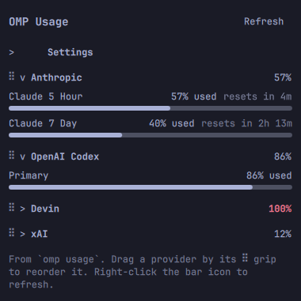

# Ohm-My-Usage-archy-Pi

OMP provider usage in the Omarchy bar. See a chosen provider's current limit at a glance, then open the panel for every provider's usage windows and reset countdowns.


## Highlights

- Reads the JSON output from `omp usage --json`.
- Select a provider or use Auto to show the most-used limit.
- Choose the `5h` or `7d` usage window and display either usage or remaining capacity.
- Show the provider label, percentage, both, or neither in the bar.
- Browse provider details in a compact, collapsible panel with optional progress bars.
- Reorder providers by dragging; collapse state and order persist locally.
- Refresh on demand or on a configurable interval; a failed refresh keeps the last good values and marks them stale.

## Requirements

Requires Omarchy Quattro and the `omp` command from Oh My Pi on `PATH`, configured for the providers whose usage you want to see. The plugin reads OMP's JSON output and does not implement a separate provider-authentication flow.

## Install

```bash
omarchy plugin add https://github.com/AventurineDream/Ohm-My-Usage-archy-Pi.git --enable
```

Remove it with:

```bash
omarchy plugin remove aven.omp-usage
```

## Use

The bar shows the configured provider's usage. In Auto mode, it chooses the available limit with the highest usage. Left-click opens the provider panel; right-click requests an immediate refresh.

The panel starts with the first two providers expanded and the remaining providers collapsed. Click a provider heading to expand or collapse it. Drag the grip to change the order; newly appearing providers are added at the end. These choices are saved in `~/.config/omarchy/omp-usage-state.json` and do not change which provider is shown in the bar.



*Screenshots use deterministic sample provider data; displayed values are illustrative.*

## Settings

The panel's Settings section and Omarchy plugin settings expose the following options:

| Option | Values and purpose |
|---|---|
| `provider` | OMP provider ID, or Auto. |
| `barWindow` | `auto`, `5h`, or `7d`; Auto chooses the most-used available limit. |
| `showAs` | `used` or `left`. |
| `showProvider` | Include the provider's short name in the bar. |
| `showBarValue` | Include the numeric usage value. |
| `showPanelBars` | Show/hide progress bars in the panel. |
| `refreshIntervalSec` | Polling interval in seconds; default 300. |

If a refresh fails, the widget retains the last successful values and marks them stale instead of replacing them with empty data.

## Development

Run the model tests with Node.js:

```bash
node test/OmpUsageModel.test.js
```

## License

MIT. See [LICENSE](LICENSE).
